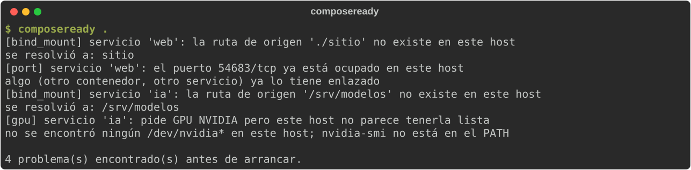

# composeready

Comprueba si el host real cumple lo que un `docker-compose.yml` asume,
**antes** de lanzar `docker compose up` — no después, cuando el error ya
salió confuso y a medias.

Tres cosas que Docker solo descubre en el momento:

- **Rutas de bind-mount**: si `./data:/app/data` apunta a algo que no
  existe en este host, Docker falla con un error sobre la ruta — pero solo
  cuando ya intentó arrancar el contenedor.
- **Puertos publicados**: si `8080:80` ya está ocupado por otra cosa, el
  error de "address already in use" no siempre deja claro *qué* servicio
  del compose falló ni por qué.
- **GPU/NVIDIA**: si el servicio pide `runtime: nvidia`, `gpus: all`, un
  dispositivo CDI `nvidia.com/gpu=...` o `deploy.resources.reservations.devices`
  con `driver: nvidia` y el host
  no tiene el runtime instalado, el contenedor puede arrancar igualmente
  — solo que corriendo por CPU, en silencio, sin ningún error visible.

`composeready` lee el YAML y comprueba las tres cosas contra el host real
en el que se ejecuta, sin arrancar ningún contenedor.

## Así se ve



<sub>Ejecución real sobre un `compose.yaml` cuyo puerto ya está ocupado, con carpetas que no existen y que pide una GPU que el equipo no tiene (todos los datos son ficticios).</sub>

## Instalación

```bash
pip install composeready
```

## Uso

```bash
composeready                        # busca docker-compose.yml en el directorio actual
composeready ruta/al/compose.yml    # o un fichero concreto
composeready --skip gpu .           # omite un check (bind_mount, port, gpu)
```

Sale con código 1 si encuentra algo, 0 si el host está listo.

## Qué NO comprueba (a propósito)

- Rangos de puertos (`8080-8090:80-90`) — poco frecuentes, mucho parseo
  extra para el valor que aportan.
- UDP — un simple `bind()` no dice de forma fiable si un puerto UDP está
  realmente en uso.
- Que la GPU *funcione* de verdad (versión de CUDA, memoria libre...) —
  solo que exista al menos un `/dev/nvidia*` y el binario `nvidia-smi`.
  Es la comprobación mínima determinista de "¿hay GPU aquí siquiera?",
  no un diagnóstico completo del stack NVIDIA.
- Sustitución de variables más allá de `${VAR}`, `${VAR:-def}`, `${VAR-def}`
  y `$VAR` — no reimplementa el intérprete completo de Compose. Las variables
  salen, como en Compose, del `.env` de la carpeta del proyecto y del entorno
  (que tiene prioridad).

## Desarrollo

```bash
python -m venv .venv && source .venv/bin/activate
pip install -e ".[dev]"
ruff check .
pytest
```
